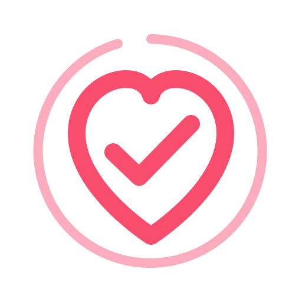
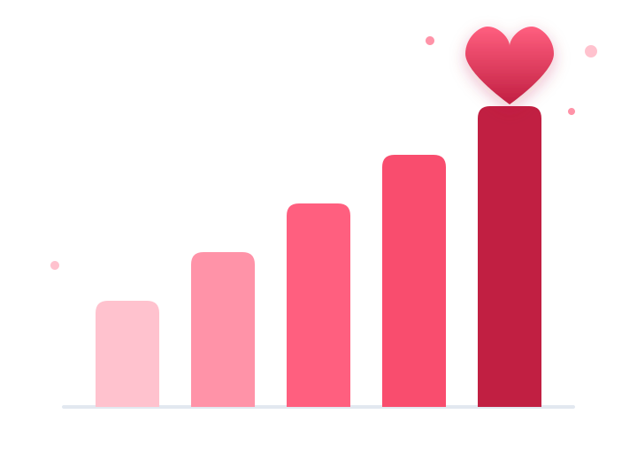

<div align="center">



# Re-Late · Plataforma de Marketing Solidario

**Asociación de Enfermos de Rehabilitación Cardiaca · Comunidad Autónoma de Aragón**
*Entidad declarada de interés social*




</div>

---

## 📋 Descripción

Plataforma integral de **marketing y gestión de relaciones** diseñada específicamente para **Re-Late**, asociación de pacientes con actividad en **Zaragoza, Huesca y Teruel**.

Integra CRM segmentado, automatización de campañas, analítica visual, gestión de voluntariado, captación de fondos, financiación pública y privada, y cumplimiento legal sanitario, todo en una única aplicación que funciona **sin servidor** y **sin conexión**.

---

## ✨ Funcionalidades

### Bloque 1 · Núcleo y cumplimiento
- **Panel de control** con KPIs de socios, donaciones, financiación, voluntariado y alcance.
- **CRM segmentado** en 7 perfiles: pacientes, familiares, socios, voluntarios, personal sanitario, periodistas e instituciones.
- **Buscador en vivo**, filtros por segmento con contadores, ordenación por columnas y paginación.
- **Ficha de contacto** con historial de interacciones y datos clínicos protegidos.
- **Campañas de email** con métricas de envío, apertura y clics, y **5 flujos automatizados**.
- **Calendario editorial unificado** y páginas de aterrizaje con tasa de conversión.
- **Analítica** con gráficos de socios, perfiles, alcance, donaciones y financiación.
- **RGPD**: consentimiento versionado (v2.1), libro de evidencias, doble opt-in y revocación.
- **Derechos ARCO+** con control del plazo legal de un mes y alertas.
- **Auditoría** de accesos, consultas de datos de salud y exportaciones.
- **Accesibilidad WCAG 2.2 AA**: teclado, ARIA, foco visible, texto grande, alto contraste y reducción de movimiento.
- **7 roles** con permisos granulares y datos de demostración en Aragón.

### Bloque 2 · Operación de la asociación
- **Voluntariado y turnos** con disponibilidad, formación, horas acumuladas y **check-in mediante código QR**.
- **Subvenciones y patrocinios**: pipeline de 6 fases, control de documentación, justificación económica y calculadora de desgravación para empresas (Ley 49/2002).
- **Portal de la persona socia**: autoservicio de datos, aportaciones, certificados fiscales, ejercicio de derechos y baja voluntaria.
- **Donaciones y pagos**: simulador con Bizum, Redsys y SEPA, recibos correlativos, certificados fiscales y **Modelo 182**.

### Bloque 3 · Medición avanzada
- **Comparativa interanual** 2026 frente a 2025.
- **Objetivos del ejercicio con semáforos** (verde ≥ 100 %, ámbar ≥ 85 %, rojo < 85 %).
- **Atribución por canal (UTM)** con coste por donante captado y ROAS.
- **Encuestas de satisfacción y NPS** integrados.
- **Cuadro de mando de impacto social** con aproximación al **SROI** (retorno por cada euro invertido).
- **Informes programados** por correo a la junta directiva, hospitales y administraciones.

---

## 🔑 Acceso a la demostración

Contraseña para **todos** los perfiles: `relate2026`

| Usuario | Perfil | Ámbito |
|---|---|---|
| `admin` | Administración | Acceso completo |
| `comunicacion` | Comunicación y Marketing | Campañas, CRM, analítica |
| `tesoreria` | Tesorería y financiación | Fondos, subvenciones, auditoría |
| `voluntariado` | Coordinación de Voluntariado | Turnos, voluntariado, portal |
| `junta` | Junta Directiva | Analítica, impacto, informes (solo lectura) |
| `sanidad` | Equipo sanitario | CRM y RGPD |
| `socio` | Persona socia | Solo su propio portal |

> También puedes entrar pulsando directamente cualquiera de las tarjetas de rol de la pantalla de acceso.

---

## 📁 Estructura del proyecto

```
re-late/
├── index.html              Aplicación completa (interfaz, lógica y datos)
├── manifest.json           Configuración de la aplicación instalable
├── sw.js                   Service worker (funcionamiento sin conexión)
├── README.md               Este documento
├── generar-iconos.html     Utilidad para generar los iconos PNG
└── icons/
    ├── icon.svg            Icono vectorial de la aplicación
    ├── icon-192.png        Icono 192 × 192
    ├── icon-512.png        Icono 512 × 512
    ├── icon-maskable-512.png  Icono adaptativo para Android
    ├── logo.svg            Logotipo transparente
    └── grafico-corazon.svg Gráfico de barras con corazón
```

---

## 🚀 Puesta en marcha local

1. Descarga o clona el repositorio.
2. Abre `index.html` con doble clic en Chrome, Edge o Firefox.

> **Nota:** abierto como archivo local (`file://`) la aplicación funciona, pero el *service worker* no se activa. Para probar la instalación como app necesitas servirla por `http` o `https`.

Para servirla en local:

```bash
# Con Python 3
python -m http.server 8080

# Con Node.js
npx serve .
```

Después abre `http://localhost:8080`.

---

## 🌐 Publicación en GitHub Pages

1. Crea un repositorio nuevo, por ejemplo `re-late`.
2. Sube todos los archivos (incluida la carpeta `icons/`).
3. Entra en **Settings → Pages**.
4. En *Source* elige **Deploy from a branch** → rama `main` → carpeta `/ (root)`.
5. Guarda y espera un minuto.

La aplicación quedará disponible en:

```
https://TU-USUARIO.github.io/re-late/
```

---

## 📲 Instalación como aplicación (PWA)

Con la aplicación abierta en la dirección de GitHub Pages:

- **Android / Chrome:** menú ⋮ → *Instalar aplicación*.
- **iPhone / Safari:** botón Compartir → *Añadir a pantalla de inicio*.
- **Escritorio / Chrome o Edge:** icono de instalar en la barra de direcciones.

Se añadirá un icono con el corazón de Re-Late y funcionará **sin conexión**.

---

## 🔒 Datos, privacidad y RGPD

> **Importante:** esta versión es una **demostración funcional**. Los datos se guardan en el almacenamiento local del navegador (`localStorage`) y **no deben introducirse datos reales de salud**.

- Los datos **no salen del dispositivo** y no se envían a ningún servidor.
- Los datos de demostración son **ficticios**.
- Las contraseñas están en el código: **no reutilizar** en servicios reales.
- Haz copias periódicas con **Acerca del programa → Copia de seguridad (JSON)**.

Para gestionar datos reales de pacientes será necesario un **backend con base de datos, autenticación real, cifrado y las garantías del RGPD** (registro de actividades de tratamiento, EIPD, delegado de protección de datos y contrato con el proveedor).

---

## 🛠️ Tecnologías

| Tecnología | Uso |
|---|---|
| HTML5 + CSS3 | Estructura y presentación |
| JavaScript (vanilla) | Toda la lógica de la aplicación |
| Tailwind CSS (CDN) | Sistema de diseño |
| Chart.js | Gráficos y visualizaciones |
| qrcode.js | Códigos QR de los turnos de voluntariado |
| localStorage | Persistencia de datos en el navegador |
| Service Worker + Manifest | Aplicación instalable y sin conexión |

---

## 🗺️ Hoja de ruta

- [x] **Bloque 1** — Núcleo, CRM, campañas, analítica, RGPD y accesibilidad
- [x] **Bloque 2** — Voluntariado, subvenciones, portal del socio y donaciones
- [x] **Bloque 3** — Comparativa interanual, atribución UTM, NPS, SROI e informes programados
- [x] **PWA** — Aplicación instalable y funcionamiento sin conexión
- [ ] **Backend y base de datos** — Multiusuario real y datos compartidos
- [ ] **Integraciones reales** — Brevo (correo), Redsys + Bizum (pagos), GA4 (analítica)
- [ ] **Cumplimiento RGPD de producción** — Cifrado, EIPD y DPD

---

## 👤 Autoría

**Miguel Ángel Layunta López**
Autor y responsable del proyecto · Re-Late

---

## 📄 Licencia

Proyecto desarrollado para **Re-Late, Asociación de Enfermos de Rehabilitación Cardiaca** (Aragón).
Los datos incluidos son ficticios y se utilizan únicamente con fines de demostración.

<div align="center">

Hecho con ❤️ para las personas que cuidan su corazón

</div>
